<div align="center">

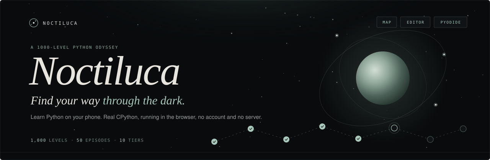

<br/>

<!-- identity -->

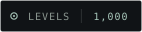
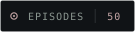


<br/>

<!-- stack -->
<a href="https://react.dev">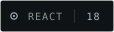</a>
<a href="https://www.typescriptlang.org">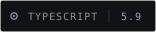</a>
<a href="https://vite.dev"></a>
<a href="https://codemirror.net"></a>

<br/>

<!-- runtime -->
<a href="https://pyodide.org"></a>


<br/>

<!-- platform -->


<a href="https://hassanireza.github.io/noctiluca/"></a>

<br/><br/>

*Learn Python one small program at a time. Follow a constellation of a thousand levels, write real code on your phone, and watch it run in the browser.*

<br/>

[Overview](#overview) · [Features](#features) · [Architecture](#architecture) · [Execution](#execution) · [Curriculum](#curriculum) · [Progression](#progression) · [Mobile](#mobile) · [Design system](#design-system) · [Authoring](#authoring-levels) · [Getting started](#getting-started) · [Deployment](#deployment) · [Notes](#technical-notes)

<br/>

**[Play it live](https://hassanireza.github.io/noctiluca/)**

</div>

---

<a id="overview"></a>
##  Overview

**Noctiluca** is a mobile-first Python puzzle game. A thousand short coding traces are arranged as fifty episodes of twenty levels. You read a prompt, write a small program, and run it. The program executes in your browser, its output is compared with the authored solution, and a match lights the level.

Everything runs on the client:

- **The map** lists every episode, newest first, with level 001 and the start action at the bottom. Any level can be opened at any time.
- **The editor** is CodeMirror 6 with Python highlighting, line numbers, an indent button and a row of the symbols that phone keyboards bury.
- **The runtime** is Pyodide, which is CPython compiled to WebAssembly, running inside a Web Worker. Your code is never sent to a server.

There is no backend, no account and no analytics. Progress is stored in `localStorage`.

The visual language is a restrained dark notebook: near-black surfaces, a single sage accent, Playfair Display italics for display text, DM Sans for interface copy and DM Mono for code, eyebrows and numbers.

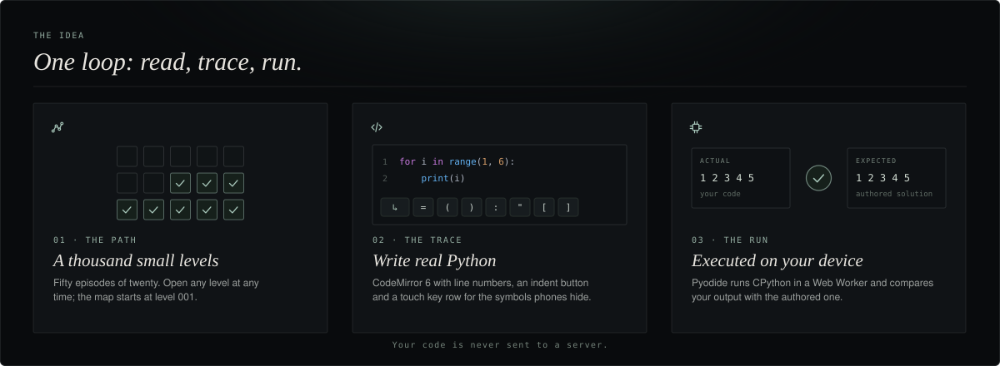

---

<a id="features"></a>
##  Features

<table>
<tr>
<td width="50%" valign="top">

 **The path**
- 1,000 levels in 50 episodes of 20
- Ten difficulty tiers that add one new concept at a time
- Open any level whenever you like
- The start action always returns to level 001
- Each episode has its own tint from a ten-colour palette

</td>
<td width="50%" valign="top">

 **The editor**
- CodeMirror 6 with Python language support and the one-dark theme
- Line numbers, a reset button and an on-demand hint
- A dedicated indent button and a row of `= ( ) : " ' [ ]`
- Key buttons never steal focus from the editor
- 16 px editor text on phones

</td>
</tr>
<tr>
<td width="50%" valign="top">

 **The runtime**
- Pyodide 0.29.5 in a module Web Worker
- Output is compared with the authored solution's output
- Function levels can add a test probe run against both programs
- Python errors show the last three traceback lines
- A 120 second guard recovers from a stalled download

</td>
<td width="50%" valign="top">

 **Progression**
- Essence per level: 10 plus 2 per tier
- Day streak that survives the same day and grows on consecutive days
- Progress saved locally and restored on load
- Header counters for streak and essence

</td>
</tr>
<tr>
<td width="50%" valign="top">

 **Design**
- Near-black palette with one sage accent
- Playfair Display, DM Sans and DM Mono
- Square corners and hairline borders
- Motion is limited to subtle hover transitions, and the main ones are gated on `prefers-reduced-motion`

</td>
<td width="50%" valign="top">

 **Platform**
- Mobile-first, with a wider ten-column grid on larger screens
- Web App Manifest and 192 / 512 px icons
- Safe-area insets for notched and home-bar devices
- Static hosting on GitHub Pages through GitHub Actions

</td>
</tr>
</table>

---

<a id="architecture"></a>
##  Architecture

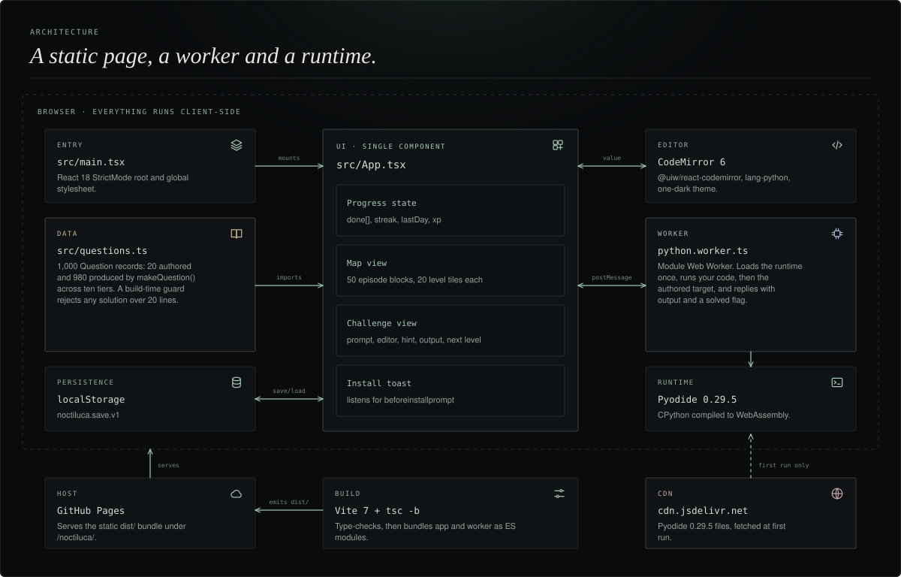

The app is small on purpose: one React component, one data module and one worker.

**`main.tsx`** mounts `App` inside `React.StrictMode` and loads the stylesheet.

**`App.tsx`** owns the whole interface. It holds the progress record, the active level, the editor text and the run state, and it renders either the map or the challenge view. It talks to the editor through `@uiw/react-codemirror` and to the runtime through a single module worker that it creates lazily and reuses.

**`questions.ts`** exports the 1,000 `Question` records and the episode palette. Twenty are authored by hand. The remaining 980 come from `makeQuestion()`, which picks a template from the level's tier and throws at build time if a solution would exceed 20 lines.

**`python.worker.ts`** imports Pyodide from jsDelivr, loads it once, and handles one run request at a time.

**Persistence** is a single `localStorage` key, `noctiluca.save.v1`, holding the solved level ids, the streak, the last solve day and the essence total.

---

<a id="execution"></a>
##  Execution

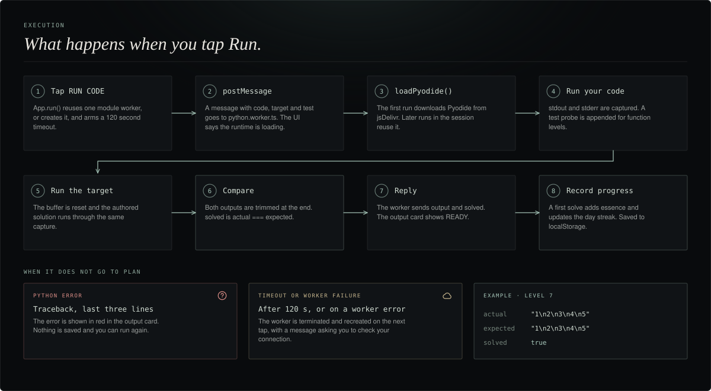

A run is a comparison of two programs. The worker executes your code and captures everything it prints, then resets the buffer, executes the authored solution and captures that. Both outputs are trimmed at the end and compared as strings.

```ts
// python.worker.ts, simplified
await py.runPythonAsync(code + (test ? `\n${test}` : ''))      // your program
const actual = output.trimEnd()
output = ''
await py.runPythonAsync(target + (test ? `\n${test}` : ''))    // the authored one
const expected = output.trimEnd()
self.postMessage({ output: actual, solved: actual === expected })
```

| Message | Direction | Payload |
|---|---|---|
| Run request | App to worker | `{ code, target, test? }` |
| Phase update | Worker to App | `{ phase: 'loading' \| 'running' }` |
| Result | Worker to App | `{ output, solved }` |
| Failure | Worker to App | `{ error }`, the last three lines of the Python traceback |

Because the check compares output rather than source, any correct approach is accepted. A function level that only defines a function prints nothing, so it carries a `test` probe such as `print(double(6))` that is appended to both programs.

---

<a id="curriculum"></a>
##  Curriculum

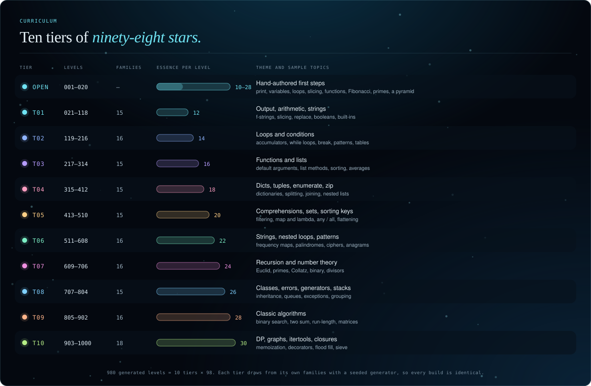

Levels 1 to 20 are hand-authored and cover printing, arithmetic, variables, loops, slicing, conditions, functions, collections, Fibonacci, palindromes, sets, primes and a star pyramid. From level 21 the generator takes over. A level's tier is `ceil(id / 100)`, and from tier 3 onward one extra concept becomes available per tier, each appearing on one level in ten.

| Tier | Levels | Essence | Adds |
|---|---|---|---|
| 1 | 001 to 100 | 12 | Ten base templates |
| 2 | 101 to 200 | 14 | Scaled values and words |
| 3 | 201 to 300 | 16 | Powers |
| 4 | 301 to 400 | 18 | Boolean functions |
| 5 | 401 to 500 | 20 | List analysis with `max()` |
| 6 | 501 to 600 | 22 | Comprehensions |
| 7 | 601 to 700 | 24 | Sets and sorting |
| 8 | 701 to 800 | 26 | Recursion |
| 9 | 801 to 900 | 28 | Frequency maps |
| 10 | 901 to 1000 | 30 | Nested patterns |

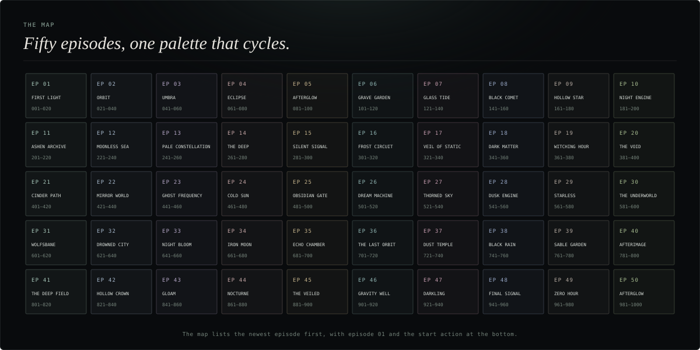

The map groups levels into episodes of twenty. Episode names live in `App.tsx`, and the ten-colour tint palette lives in `questions.ts`; the palette repeats every ten episodes.

---

<a id="progression"></a>
##  Progression

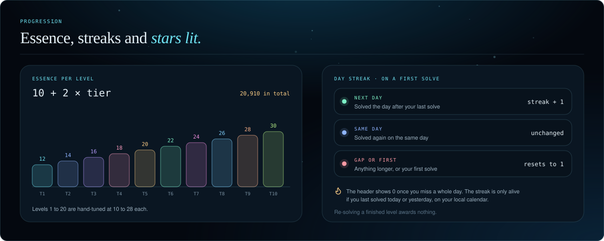

Progress is only recorded on the first solve of a level. Re-solving a finished level changes nothing.

| Rule | Behaviour |
|---|---|
| Essence | Added once per level. Generated levels award `10 + 2 × tier`; authored levels award 10 to 28 |
| Total available | 21,090 essence across all 1,000 levels |
| Streak, next day | Solving the day after your last solve adds 1 |
| Streak, same day | Unchanged |
| Streak, gap or first solve | Resets to 1 |
| Day boundary | UTC calendar date |

```jsonc
// localStorage["noctiluca.save.v1"]
{ "done": [1, 2, 3], "streak": 3, "lastDay": "2026-10-22", "xp": 36 }
```

---

<a id="mobile"></a>
##  Mobile

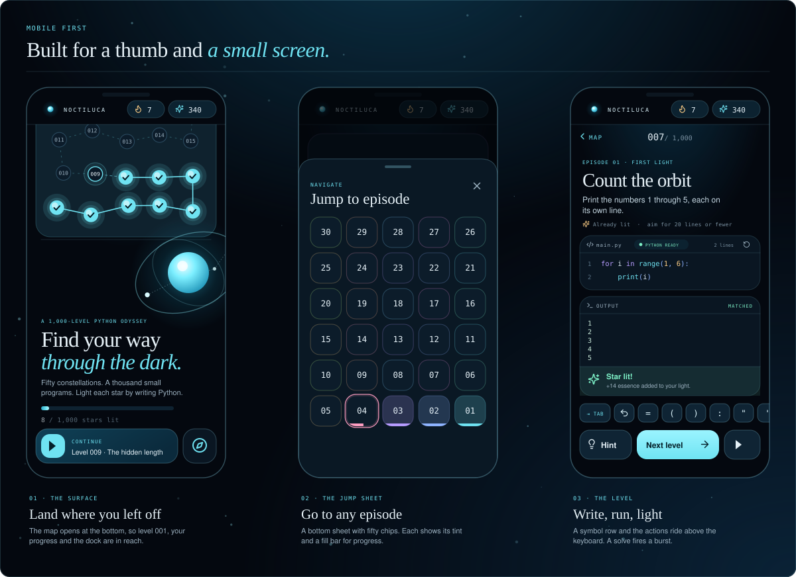

*The mockups above are illustrations drawn from the real layout and design tokens, not screenshots.*

- The map scrolls to the bottom on entry, so level 001 and the start action are immediately reachable.
- Level tiles use five columns on phones and ten from 700 px up.
- The editor text is 16 px on phones.
- The key row sits directly under the editor. Its buttons cancel `mousedown`, so tapping a symbol does not dismiss the keyboard.
- Spacing respects `env(safe-area-inset-bottom)`.

**Install on iPhone.** Open the deployed site in Safari, tap **Share**, then **Add to Home Screen**. Chromium browsers show an install prompt through `beforeinstallprompt`, which the app surfaces as a small toast.

---

<a id="design-system"></a>
##  Design system

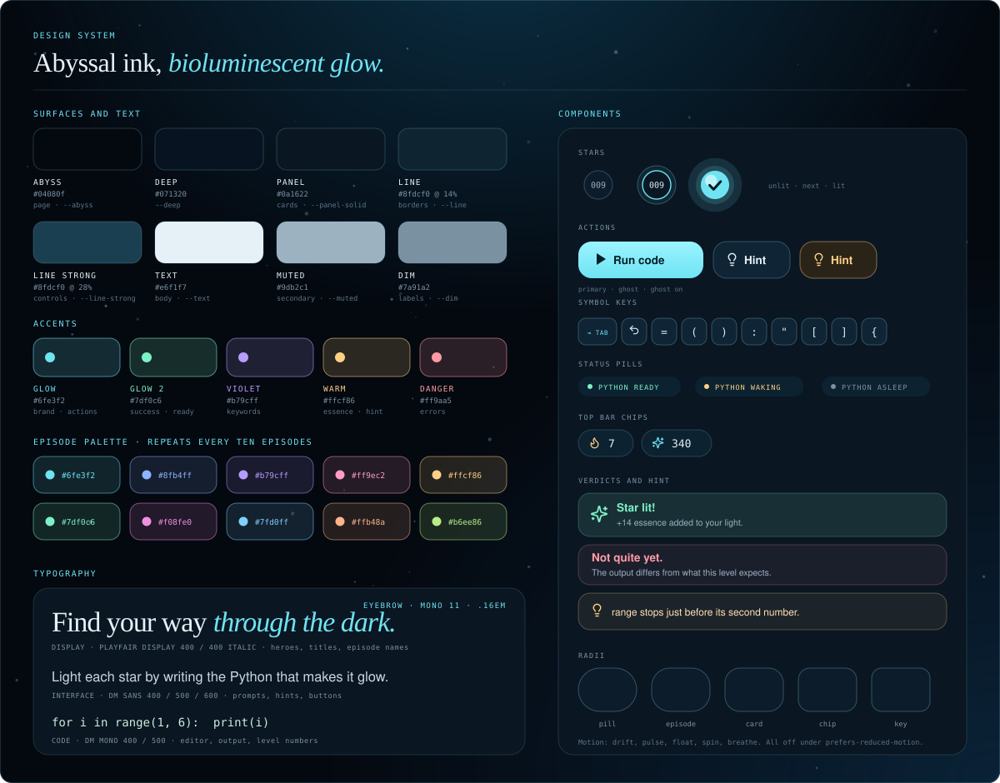

Five values are declared as CSS custom properties on `:root`: `--muted`, `--line`, `--accent`, `--panel` and the two font stacks `--mono` and `--serif`. Everything else is a literal in `src/style.css`.

| Role | Value | Where it appears |
|---|---|---|
| Background | `#090b0d` | Page |
| Panel | `#101316` (`--panel`) | Cards |
| Editor | `#0e1114` | Editor and output cards |
| Line | `rgba(219, 225, 225, .1)` (`--line`) | Hairline borders |
| Text | `#e8e5df` | Primary text |
| Muted | `#777c7e` (`--muted`) | Secondary text |
| Accent | `#a8c8bb` (`--accent`) | Brand, actions, completed state |
| Error | `#dc8e87` | Python error output |

```
--serif  Playfair Display   headings, brand moments, italic
body     DM Sans            prompts, hints, interface copy
--mono   DM Mono            editor, output, eyebrows, stats
```

The brand mark is a thin ring with three dots, drawn in CSS inside the app and as a PNG in the install icons. The moon on the hero is a radial gradient with two rotated orbit rings.

---

<a id="authoring-levels"></a>
##  Authoring levels

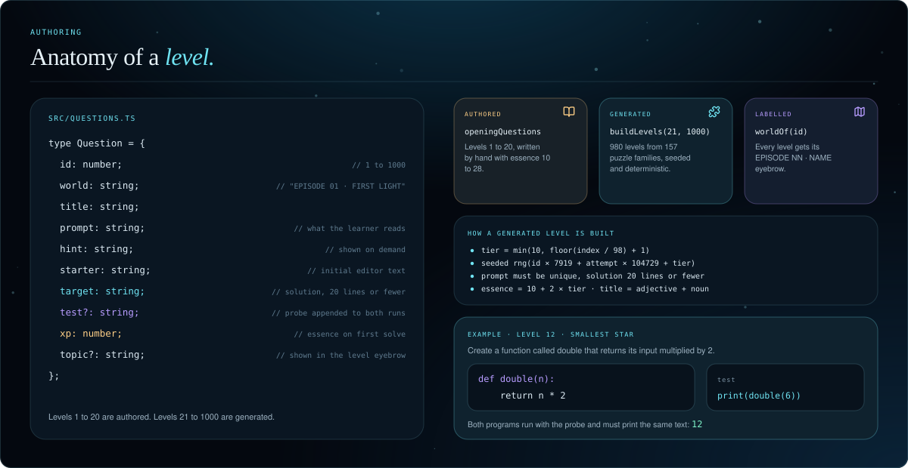

To add or change an authored level, edit `openingQuestions` in `src/questions.ts`. To change the generated sequence, edit the templates inside `makeQuestion()`.

Guidelines:

- Keep every solution at **20 lines or fewer**. `makeQuestion()` throws at build time if a generated level exceeds the limit.
- Write a short prompt and a one-line hint.
- For a function level, add a `test` probe that calls the function and prints the result, because the check compares printed output.
- Ids are 1-based and contiguous. The map is hard-coded to 50 episodes of 20 and the interface text says `1000`, so changing the level count also means editing `App.tsx`.

---

<a id="getting-started"></a>
##  Getting started

**Prerequisites:** Node.js 22 or later, and npm.

```bash
git clone https://github.com/hassanireza/noctiluca.git
cd noctiluca
npm install
npm run dev
```

Open **http://localhost:5173/noctiluca/**. Vite serves the app under its configured base path, so the trailing `/noctiluca/` matters in development too.

```bash
npm run build      # tsc -b, then vite build into dist/
npm run preview    # serve the production build locally
```

The first time you press **Run**, the browser downloads the Pyodide runtime from jsDelivr, so a connection is needed once per session.

### Forking under another name

The base path `/noctiluca/` is set in three places. Change all of them together:

| File | Setting |
|---|---|
| `vite.config.ts` | `base` |
| `public/manifest.webmanifest` | `start_url`, `scope` and the two icon `src` paths |
| `public/sw.js` | cached paths |

---

<a id="deployment"></a>
##  Deployment

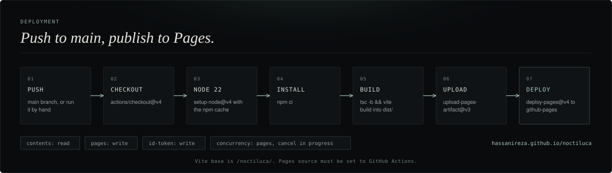

`.github/workflows/pages.yml` runs on every push to `main` and on manual dispatch. It sets up Node 22 with npm caching, runs `npm ci` and `npm run build`, uploads `dist/` and deploys it with `actions/deploy-pages`.

**To enable:** open **Settings, Pages, Build and deployment** and choose **GitHub Actions** as the source. The site is then served at `https://hassanireza.github.io/noctiluca/`.

---

##  Project structure

```
noctiluca/
├── assets/                        README artwork
│   ├── banner.svg                 Header banner
│   ├── footer.svg                 Footer mark
│   ├── pillars.svg                The path, the trace, the run
│   ├── architecture.svg           Component diagram
│   ├── run-flow.svg               Execution pipeline
│   ├── curriculum.svg             Ten tiers
│   ├── episodes.svg               Fifty episodes
│   ├── progress.svg               Essence and streak rules
│   ├── mobile.svg                 Phone mockups
│   ├── design-system.svg          Palette, type, components
│   ├── level-anatomy.svg          The Question type
│   ├── deploy.svg                 CI/CD pipeline
│   ├── badges/                    Brand-styled badge SVGs
│   └── icons/                     24 px icon family used in headings
├── public/
│   ├── favicon.svg                Tab icon referenced by index.html
│   ├── icon-192.png               Install icon
│   ├── icon-512.png               Install icon
│   ├── manifest.webmanifest       Web App Manifest
│   └── sw.js                      Service worker (not yet registered)
├── src/
│   ├── main.tsx                   React entry point
│   ├── App.tsx                    Map, challenge view, progress, install toast
│   ├── questions.ts               Authored levels, makeQuestion(), palette
│   ├── python.worker.ts           Pyodide worker: run, capture, compare
│   ├── pyodide-cdn.d.ts           Type shim for the CDN import
│   └── style.css                  All styles
├── .github/workflows/pages.yml    CI/CD to GitHub Pages
├── index.html                     Vite entry point
├── vite.config.ts                 Vite config, base path /noctiluca/
├── tsconfig.json                  TypeScript options
└── package.json
```

---

##  Component reference

### `<App />`

The only component. It reads progress lazily from `localStorage` and writes it back on every change.

| State | Type | Purpose |
|---|---|---|
| `progress` | `{ done, streak, lastDay, xp }` | Solved ids, day streak and essence |
| `active` | `number \| null` | Index of the open level, or `null` for the map |
| `code` | `string` | Editor contents, reset to the level's starter on open |
| `output` / `error` | `string` | Result of the last run |
| `checking` | `boolean` | A run is in flight |
| `showHint` | `boolean` | Hint panel visibility |
| `install` / `installPrompt` | `boolean` / event | Install toast and the deferred prompt |

| Function | Role |
|---|---|
| `readProgress()` | Parses the saved record and falls back to zeros on any error |
| `openQuestion(id)` | Opens a level if the id is in range |
| `run()` | Creates or reuses the worker, arms the timeout, posts the request and applies the reply |
| `insert(text)` | Types a symbol into the editor through the key row |
| `installApp()` | Shows the deferred install prompt |

### `Question`

```ts
type Question = {
  id: number; world: string; title: string; prompt: string; hint: string
  starter: string; target: string; test?: string; xp: number
}
```

### Worker protocol

```ts
// App to worker
worker.postMessage({ code, target: q.target, test: q.test })
// Worker to App
{ phase: 'loading' | 'running' }            // progress
{ output: string, solved: boolean }         // result
{ error: string }                           // Python failure
```

---

##  Privacy and data

| What | Where | Why |
|---|---|---|
| Solved levels, streak, last solve day, essence | `localStorage`, key `noctiluca.save.v1` | Resume where you left off |
| Your code | Memory only | Run in a local Web Worker and discarded |
| Network requests | GitHub Pages, `cdn.jsdelivr.net`, Google Fonts | The app, the Pyodide runtime, the typefaces |

There is no analytics code and no server of our own. Clearing site data removes the saved progress.

---

<a id="technical-notes"></a>
##  Technical notes

These are the current boundaries of the project, stated plainly.

- **A connection is needed on first run.** Pyodide is imported from jsDelivr rather than bundled, so the first execution in a session downloads the runtime.
- **No offline mode yet.** `public/sw.js` exists but is not registered in `main.tsx`, so the app does not currently work offline.
- **Output matching.** Correctness is judged by printed output, so a program that prints the right text by other means is accepted.
- **One test probe.** Only level 12 uses the `test` field today. In the generated function levels the authored solution calls and prints the function itself, so your program has to do the same to match.
- **Streak days use UTC.** The day changes at midnight UTC, not local midnight.
- **No automated tests or linter** are configured in `package.json` yet.

---

<a id="licenses"></a>
##  Credits and third-party components

| Component | License | Notes |
|---|---|---|
| React and React DOM | MIT | UI |
| CodeMirror 6, `@uiw/react-codemirror` | MIT | Editor, Python language support, one-dark theme |
| Pyodide | MPL 2.0 | CPython on WebAssembly, loaded from jsDelivr |
| lucide-react | ISC | Interface icons |
| Vite, TypeScript | MIT, Apache 2.0 | Build tooling |
| Playfair Display, DM Sans, DM Mono | SIL OFL 1.1 | Loaded from Google Fonts |

The provided Pyxis project was used as a visual reference for its restrained dark notebook palette and monospaced code surface. No Pyxis code or branding is included in this app.

---

##  Contributing

1. Fork the repository
2. Create a branch: `git checkout -b feat/my-change`
3. Make your changes and run `npm run build`
4. Open a pull request against `main`

Guidelines:

- **Solutions stay short.** Twenty lines or fewer, always.
- **Function levels need a probe.** Add a `test` so the check has something to print.
- **Match the look.** Square corners, hairline borders, one accent per episode, DM Mono for anything that is code, a number or an eyebrow.
- **Icons.** Lucide icons in the app; the README icon family uses a 24 px grid with a 1.2 stroke and round caps.

---

<div align="center">

<br/>

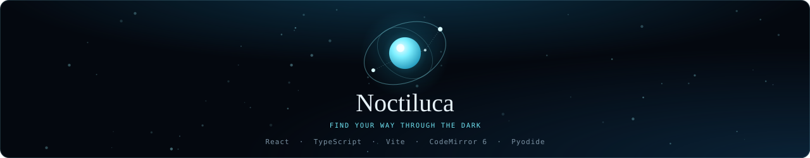

</div>
