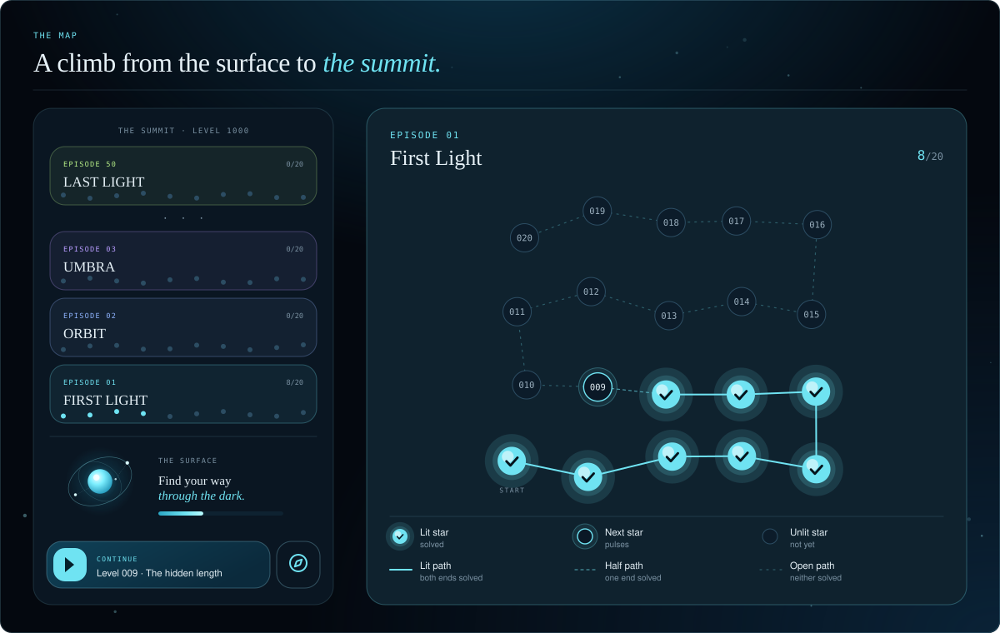
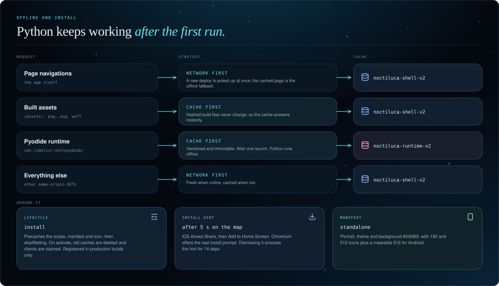
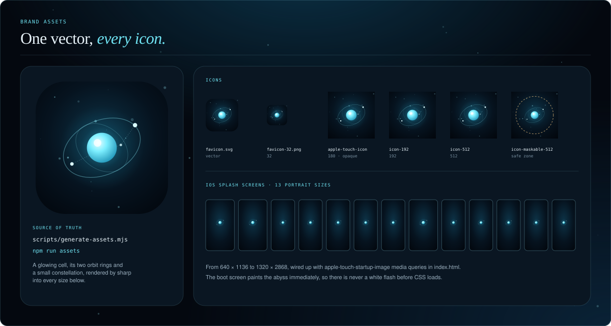
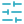

<div align="center">


<br/>

<!-- identity -->


<br/>

<!-- stack -->
<a href="https://react.dev"></a>
<a href="https://www.typescriptlang.org"></a>
<a href="https://vite.dev"></a>
<a href="https://codemirror.net"></a>

<br/>

<!-- runtime -->
<a href="https://pyodide.org"></a>


<br/>

<!-- platform -->


<a href="https://hassanireza.github.io/noctiluca/"></a>

<br/><br/>

*Fifty constellations. A thousand small programs. Light each star by writing the Python that makes it glow, on your phone, in the dark.*

<br/>

[Overview](#overview) · [Features](#features) · [The map](#the-map) · [Architecture](#architecture) · [Execution](#execution) · [Curriculum](#curriculum) · [Progression](#progression) · [Mobile](#mobile) · [Offline](#offline-and-install) · [Design system](#design-system) · [Authoring](#authoring-levels) · [Getting started](#getting-started) · [Deployment](#deployment) · [Notes](#technical-notes)

<br/>

**[Play it live](https://hassanireza.github.io/noctiluca/)**

</div>

---

<a id="overview"></a>
##  Overview

**Noctiluca** is a pocket-sized Python journey through the dark. A thousand short coding puzzles are arranged as fifty constellations of twenty stars. You read a prompt, write a small program and run it. It executes in your browser, its output is compared with the authored solution, and a match lights the star.

The name comes from the bioluminescent plankton that glows when disturbed, and the whole interface plays on that: a deep-sea backdrop of drifting specks, a ripple of light wherever you tap, and a glowing cell as the mark.

Everything runs on the client:

- **The map** is a vertical climb from the surface at the bottom to the summit at level 1000. Every episode is a constellation whose stars and paths light up as you progress.
- **The editor** is CodeMirror 6, tuned for phones, with auto-closing brackets, no autocorrect and a row of the symbols that phone keyboards bury.
- **The runtime** is Pyodide, which is CPython compiled to WebAssembly, running inside a Web Worker. Your code is never sent to a server.

There is no backend, no account and no analytics. Progress is stored in `localStorage`, and after the first run the app works offline.


---

<a id="features"></a>
##  Features

<table>
<tr>
<td width="50%" valign="top">

 **The map**
- 1,000 levels in 50 episodes of 20, each drawn as its own constellation
- Stars have three states: unlit, next (pulsing) and lit
- Paths light up when both of their stars are solved
- A **Continue** dock jumps straight to your next level
- A compass opens a sheet to jump to any episode, with progress bars

</td>
<td width="50%" valign="top">

 **The editor**
- CodeMirror 6 with Python highlighting and a custom night theme
- Brackets and quotes auto-close and step over, like a real keyboard
- No autocapitalise, autocorrect or smart quotes
- A symbol row: Tab, undo and 21 symbols, none of which steal focus
- 16 px editor text and 4-space indentation

</td>
</tr>
<tr>
<td width="50%" valign="top">

 **The runtime**
- Pyodide 0.29.5 in a module Web Worker
- Starts warming up the moment you open a level
- Every run gets a fresh namespace, so nothing leaks between runs
- An 8 second guard stops infinite loops
- Output is compared with the authored solution's output

</td>
<td width="50%" valign="top">

 **Progression**
- Essence per level from 10 to 30, 20,910 in total
- A day streak that follows your local calendar
- A hint on demand, and the expected output after two misses
- A burst of light and a haptic tap on every first solve
- Progress saved locally and validated on load

</td>
</tr>
<tr>
<td width="50%" valign="top">

 **Offline and install**
- A service worker caches the shell and the Pyodide runtime
- Python keeps working offline after the first launch
- Add to Home Screen with a standalone, full-screen look
- Icons, a maskable icon and 13 iOS splash screens

</td>
<td width="50%" valign="top">

 **Design**
- Abyssal ink with bioluminescent cyan, mint, violet and amber
- Ten episode tints that repeat across the fifty constellations
- Playfair Display, DM Sans and DM Mono, bundled with the app
- Respects `prefers-reduced-motion` by switching all animation off

</td>
</tr>
</table>

---

<a id="the-map"></a>
##  The map



The map reads bottom to top. The **surface** sits at the bottom with the hero, the title and a meter of stars lit, so a new player lands right on it. Fifty episode cards stack above it, newest first, up to **the summit** at level 1000.

Each episode is a snake of twenty stars that climbs from the bottom-left, laid out by a deterministic function with a little seeded drift, so every constellation has its own shape and never changes between visits.

| Element | Behaviour |
|---|---|
| Lit star | Solved. Glows in the episode's tint and shows a check |
| Next star | The first unsolved level on the whole path. A pulsing ring |
| Unlit star | Not solved yet. Shows its level number |
| Lit path | Both ends are solved |
| Half path | One end is solved |
| Open path | Neither end is solved |
| Episode card | Shows `n/20`, or a glowing **COMPLETE** badge at twenty |
| Dock | **BEGIN** for new players, **CONTINUE** afterwards, **ALL STARS LIT · REPLAY** at the end |
| Compass | Opens a bottom sheet of fifty episode chips, each with a fill bar |

On entry the map lands where you are. New players, and anyone still in the first two episodes, land at the bottom. Everyone else is scrolled so their current episode is centred.

---

<a id="architecture"></a>
##  Architecture


The app is small and split by responsibility: one shell, two screens, a handful of components, one data layer and one worker.

**`main.tsx`** loads the bundled fonts, mounts `App` inside `React.StrictMode` and, in production builds only, registers the service worker.

**`App.tsx`** is the shell. It owns the progress record, draws the top bar and the backdrop, and chooses between the map and a level. The open level lives in the URL hash as `#/level/N`, so the iOS edge swipe or the Android back gesture closes a level and returns to the map instead of leaving the app. Moving to the next level replaces the history entry, so Back still goes to the map.

**`screens/MapScreen.tsx`** and **`screens/PlayScreen.tsx`** are the two views. Components in `components/` are `Backdrop`, `CellArt`, `Constellation`, `EpisodeSheet`, `CodeEditor` and `InstallHint`. `hooks.ts` holds `useKeyboardInset`, `useInstallHint` and `useMedia`.

**Data** is `questions.ts`, `episodes.ts` and `puzzles.ts`. Twenty levels are authored. The other 980 come from `buildLevels(21, 1000)` over 157 puzzle families.

**`python.ts`** is the client of the runtime. It spawns the worker, warms it up, runs requests and enforces the time limits. **`python.worker.ts`** loads Pyodide from jsDelivr and executes code.

**`progress.ts`** reads, validates and writes the save record under `noctiluca.save.v1`.

---

<a id="execution"></a>
##  Execution


A run is a comparison of two programs. The worker executes your code and captures everything it prints, then does the same for the authored solution. Both outputs are trimmed at the end and compared as strings.

```ts
// python.worker.ts, simplified
async function exec(py, source, test?) {
  let out = ''
  py.setStdout({ batched: (s) => { out += s + '\n' } })
  py.setStderr({ batched: (s) => { out += s + '\n' } })
  const ns = py.globals.get('dict')()            // a brand-new namespace per run
  try { await py.runPythonAsync(source + (test ? '\n' + test : ''), { globals: ns }) }
  finally { ns.destroy() }
  return out.trimEnd()
}

const actual = await exec(py, msg.code, msg.test)      // your program
const expected = await exec(py, msg.target, msg.test)  // the authored one
post({ type: 'result', id: msg.id, actual, expected, solved: actual === expected })
```

Because each run starts from an empty namespace, one run can never leak names into the next, or into the answer key. Because the check compares printed output, any correct approach is accepted.

| Limit | Value | What happens |
|---|---|---|
| Load | 120 seconds | The first launch downloads about 10 MB. On timeout a message asks you to check your connection and run again |
| Run | 8 seconds | Starts once Python is executing. A loop that never ends is cut off and the worker is recreated |

| Message | Direction | Payload |
|---|---|---|
| `warm` | Client to worker | Start loading Python without running anything |
| `run` | Client to worker | `{ id, code, target, test? }` |
| `ready` | Worker to client | The runtime is loaded |
| `running` | Worker to client | `{ id }`, Python is executing; the 8 s timer starts |
| `result` | Worker to client | `{ id, actual, expected, solved }` |
| `error` | Worker to client | `{ id, message }`, the last four lines of the Python traceback |

---

<a id="curriculum"></a>
##  Curriculum


Levels 1 to 20 are hand-authored first steps. Levels 21 to 1000 come from a library of **157 puzzle families**, split into ten tiers of 98 levels. Every level is deterministic, so the game is identical on every build, and no two prompts are the same.

| Tier | Levels | Families | Essence | Theme |
|---|---|---|---|---|
| Open | 001 to 020 | authored | 10 to 28 | Hand-authored first steps |
| 1 | 021 to 118 | 15 | 12 | Output, arithmetic, strings |
| 2 | 119 to 216 | 16 | 14 | Loops and conditions |
| 3 | 217 to 314 | 15 | 16 | Functions and lists |
| 4 | 315 to 412 | 15 | 18 | Dicts, tuples, enumerate, zip |
| 5 | 413 to 510 | 15 | 20 | Comprehensions, sets, sorting keys |
| 6 | 511 to 608 | 16 | 22 | Strings, nested loops, patterns |
| 7 | 609 to 706 | 16 | 24 | Recursion and number theory |
| 8 | 707 to 804 | 15 | 26 | Classes, errors, generators, stacks |
| 9 | 805 to 902 | 16 | 28 | Classic algorithms |
| 10 | 903 to 1000 | 18 | 30 | Dynamic programming, graphs, itertools, closures |


Episode names live in `episodes.ts` and the ten-colour palette in `questions.ts`. The palette repeats every ten episodes. Level titles for generated levels are an adjective plus a noun, such as *Opal Cipher* for level 1000.

---

<a id="progression"></a>
##  Progression


Progress is only recorded on the first solve of a level. Re-solving a finished level changes nothing, and tells you the star was already lit.

| Rule | Behaviour |
|---|---|
| Essence | Added once per level: authored levels award 10 to 28, generated levels `10 + 2 × tier` |
| Total available | 20,910 essence across all 1,000 levels |
| Streak, next day | Solving the day after your last solve adds 1 |
| Streak, same day | Unchanged |
| Streak, gap or first solve | Resets to 1 |
| Day boundary | Your **local** calendar date |
| Displayed streak | Only alive if you last solved today or yesterday; otherwise the header shows 0 |
| Next level | The first unsolved level on the whole path, or `null` when every star is lit |

```jsonc
// localStorage["noctiluca.save.v1"]
{ "done": [1, 2, 3], "streak": 3, "lastDay": "2026-10-22", "xp": 36 }
```

On load, the saved record is validated: level ids are de-duplicated and kept only if they are integers between 1 and 1000, and any malformed value falls back to zero.

---

<a id="mobile"></a>
##  Mobile


*The mockups are illustrations drawn from the real layout and design tokens, not screenshots.*

- **Keyboard-aware.** `useKeyboardInset` reads `visualViewport` and exposes the keyboard height as `--kb`, so the symbol row and the actions ride above it. When the keyboard is open the top bar hides to reclaim space.
- **A symbol row that never steals focus.** Keys cancel `pointerdown`, so tapping a symbol does not dismiss the keyboard. Brackets and quotes pair and step over like a real keyboard.
- **Warm start.** Opening a level starts loading Python while you read the prompt.
- **Back gesture.** The open level is in the URL hash, so swiping back returns to the map.
- **Safe areas.** Layout respects the notch and home bar through `env(safe-area-inset-*)`.
- **Touch targets.** Buttons, keys and chips are 44 px or larger.
- **Feedback.** A ripple follows each tap outside the editor, and a first solve vibrates for 24 ms on devices that support it.

---

<a id="offline-and-install"></a>
##  Offline and install



`public/sw.js` is registered in production builds only, so the dev server is never cached. It is scope-relative, so it works under any base path.

| Request | Strategy | Cache |
|---|---|---|
| Page navigations | Network first, cached page as the offline fallback | `noctiluca-shell-v2` |
| Built assets (`/assets/`, png, svg, woff) | Cache first | `noctiluca-shell-v2` |
| Pyodide on `cdn.jsdelivr.net/pyodide/` | Cache first | `noctiluca-runtime-v2` |
| Everything else on the same origin | Network first | `noctiluca-shell-v2` |

Pages are network first so a new deploy is picked up immediately. The Pyodide files are versioned and immutable, so once one launch has fetched them, Python runs offline.

**Install.** The manifest declares a standalone, portrait app with the abyss as its theme and background colour. After five seconds on the map, `useInstallHint` shows a small card:

- **iOS** has no install event, so the card teaches Share, then **Add to Home Screen**.
- **Chromium** browsers get the real install prompt through `beforeinstallprompt`.
- Dismissing the card snoozes it for 14 days, and it never shows in an installed app.

---

<a id="design-system"></a>
##  Design system


The tokens are declared on `:root` in `src/style.css`. The direction is *abyssal ink, bioluminescent cyan, serif headlines, mono labels*, built mobile first.

### Colour tokens

| Token | Value | Use |
|---|---|---|
| `--abyss` | `#04080f` | Page background |
| `--deep` | `#071320` | Deep surface |
| `--panel-solid` | `#0a1622` | Cards, with `--panel` at 90% |
| `--line` | `rgba(143, 220, 240, .14)` | Hairline borders |
| `--line-strong` | `rgba(143, 220, 240, .28)` | Controls and sheets |
| `--text` | `#e6f1f7` | Primary text |
| `--muted` | `#9db2c1` | Secondary text |
| `--dim` | `#7a91a2` | Labels and counters |
| `--glow` | `#6fe3f2` | Brand, actions, focus, the next star |
| `--glow-2` | `#7df0c6` | Success and a ready runtime |
| `--violet` | `#b79cff` | Keywords |
| `--warm` | `#ffcf86` | Essence, hints, a waking runtime |
| `--danger` | `#ff9aa5` | Errors and a missed match |

### Episode palette

```
#6fe3f2  #8fb4ff  #b79cff  #ff9ec2  #ffcf86
#7df0c6  #f08fe0  #7fd0ff  #ffb48a  #b6ee86
```

An episode's colour is `palette[(episode - 1) % 10]`. It sets the tint of the card, its stars, its paths and its chip in the jump sheet.

### Typography

```
--serif  Playfair Display  400 / 400 italic   heroes, titles, episode names
--sans   DM Sans           400 / 500 / 600    prompts, hints, buttons
--mono   DM Mono           400 / 500          editor, output, eyebrows, level numbers
```

Fonts are bundled through `@fontsource`, so the app makes no request to Google Fonts. Headlines are regular Playfair with an italic cyan emphasis, such as *through the dark.* Eyebrows are 11 px mono, upper case, tracked at `.16em`.

### Shape, light and motion

- **Radii** run from pills (99 px) through episode cards (22), cards (18), chips (14) and keys (12).
- **Light.** Panels are glassy navy with a tint wash. Lit stars carry a layered glow. The backdrop is two radial gradients plus 22 drifting plankton specks.
- **Motion.** `drift`, `pulse`, `float`, `spin` and `breathe`, plus a tap ripple. All animation and transitions are switched off under `prefers-reduced-motion: reduce`.
- **Icons.** [Lucide](https://lucide.dev) throughout the app and in this README.

### The mark

The mark is a bioluminescent cell: a cyan sphere with a specular highlight, a soft halo, two orbit rings and a short dotted constellation of three stars. It is the `CellArt` component in the app, and the single source for every raster icon.



`scripts/generate-assets.mjs` renders the favicon, Apple touch icon, the 192 and 512 icons, a maskable icon (with the glyph inside the Android safe zone) and 13 iOS splash screens with [sharp](https://sharp.pixelplumbing.com). Run it with `npm run assets`. It also writes `scripts/splash-links.html`, the `<link rel="apple-touch-startup-image">` tags that `index.html` uses.

---

<a id="authoring-levels"></a>
##  Authoring levels


To change one of the first twenty levels, edit `openingQuestions` in `src/questions.ts`. To add or change generated levels, edit the families in `src/puzzles.ts`. Each family is a function that takes a seeded random source and returns a prompt, a solution, a hint and a topic.

```ts
// puzzles.ts, one family in tier 1
(r) => {
  const w = r.pick(W)
  return b('Length', `Print how many characters are in "${w}".`,
           `print(len("${w}"))`, 'len() measures a string.')
}
```

`buildLevels` picks a family for each level from its tier, seeds the generator from the level id, and retries until the prompt is unique and the solution fits in 20 lines. If it cannot, the build throws.

Guidelines:

- Keep every solution at **20 lines or fewer**.
- Write one clear prompt and a one-line hint. The check compares printed output, so say exactly what to print.
- A function level that only defines a function prints nothing. Give it a `test` probe, as level 12 does, which is appended to both programs.
- Keep ids 1-based and contiguous. The map is built for 50 episodes of 20, set in `episodes.ts`.

---

<a id="getting-started"></a>
##  Getting started

**Prerequisites:** Node.js 22 or later, and npm.

```bash
git clone https://github.com/hassanireza/noctiluca.git
cd noctiluca
npm install
npm run dev
```

Open **http://localhost:5173/noctiluca/**. Vite serves the app under its configured base path, so the trailing `/noctiluca/` matters in development too.

```bash
npm run build      # tsc -b, then vite build into dist/
npm run preview    # serve the production build locally
npm run assets     # regenerate icons, favicons and iOS splash screens
```

The first time you press **Run**, the browser downloads the Pyodide runtime from jsDelivr, so a connection is needed once. After that the service worker keeps it for offline use in production builds.

### Forking under another name

Only one setting is tied to the repository name: `base` in `vite.config.ts`. The manifest, the service worker and the HTML all resolve against it.

```ts
// vite.config.ts
export default defineConfig({ plugins: [react()], base: '/your-repo-name/', /* ... */ })
```

Then update the live-site links in this README.

---

<a id="deployment"></a>
##  Deployment


`.github/workflows/pages.yml` runs on every push to `main` and on manual dispatch. It sets up Node 22 with npm caching, runs `npm ci` and `npm run build`, uploads `dist/` and deploys it with `actions/deploy-pages`.

**To enable:** open **Settings, Pages, Build and deployment** and choose **GitHub Actions** as the source. The site is then served at `https://hassanireza.github.io/noctiluca/`.

---

##  Project structure

```
noctiluca/
├── assets/                          README artwork
│   ├── banner.svg                   Header banner
│   ├── footer.svg                   Footer mark
│   ├── pillars.svg                  Map, editor, runtime
│   ├── journey.svg                  Map anatomy
│   ├── architecture.svg             Component diagram
│   ├── run-flow.svg                 Execution pipeline
│   ├── curriculum.svg               Ten tiers
│   ├── episodes.svg                 Fifty constellations
│   ├── progress.svg                 Essence and streak rules
│   ├── mobile.svg                   Phone mockups
│   ├── offline.svg                  Service worker and install
│   ├── design-system.svg            Tokens, type, components
│   ├── brand-assets.svg             Icon and splash pipeline
│   ├── level-anatomy.svg            The Question type
│   ├── deploy.svg                   CI/CD pipeline
│   ├── badges/                      Brand-styled badge SVGs
│   └── icons/                       Lucide icons used in headings
├── public/
│   ├── favicon.svg, favicon-32.png  Tab icons
│   ├── apple-touch-icon.png         iOS Home Screen icon
│   ├── icon-192.png, icon-512.png   Install icons
│   ├── icon-maskable-512.png        Android adaptive icon
│   ├── splash/                      13 iOS splash screens
│   ├── manifest.webmanifest         Web App Manifest
│   └── sw.js                        Service worker
├── scripts/
│   ├── generate-assets.mjs          Renders every icon and splash from one vector
│   └── splash-links.html            Generated startup-image link tags
├── src/
│   ├── main.tsx                     Entry: fonts, root, service worker registration
│   ├── App.tsx                      Shell: top bar, hash routing, progress state
│   ├── screens/
│   │   ├── MapScreen.tsx            Episodes, hero, dock, jump sheet
│   │   └── PlayScreen.tsx           Prompt, editor, keys, output, verdict
│   ├── components/
│   │   ├── Backdrop.tsx             Drifting specks and tap ripple
│   │   ├── CellArt.tsx              The cell mark
│   │   ├── Constellation.tsx        One episode's stars and paths
│   │   ├── EpisodeSheet.tsx         Jump to episode bottom sheet
│   │   ├── CodeEditor.tsx           CodeMirror setup and handle
│   │   └── InstallHint.tsx          Add to Home Screen card
│   ├── questions.ts                 Authored levels, assembly, palette
│   ├── puzzles.ts                   157 puzzle families and buildLevels()
│   ├── episodes.ts                  Names and counts
│   ├── progress.ts                  Save record, streaks, next level
│   ├── python.ts                    Worker client with time limits
│   ├── python.worker.ts             Pyodide worker
│   ├── hooks.ts                     Keyboard inset, install hint, media
│   ├── pyodide-cdn.d.ts             Type shim for the CDN import
│   └── style.css                    Tokens and all styles
├── .github/workflows/pages.yml      CI/CD to GitHub Pages
├── index.html                       Boot screen, meta, splash links
├── vite.config.ts                   Base path /noctiluca/
└── package.json
```

---

##  Component reference

### `<App />`

| State | Type | Purpose |
|---|---|---|
| `progress` | `{ done, streak, lastDay, xp }` | Solved ids, streak and essence, written to `localStorage` on change |
| `active` | `number \| null` | The open level from the URL hash, or `null` for the map |
| `lastLevel` | `ref` | The last level opened, so the map can scroll back to it |
| `pushed` | `ref` | Whether opening a level pushed a history entry |

`open(id)` pushes `#/level/id` from the map, or replaces it when moving between levels. `close()` goes back in history when it pushed, and otherwise clears the hash. The document title follows the level.

### `<MapScreen />` and `<PlayScreen />`

| Component | State | Notes |
|---|---|---|
| `MapScreen` | `sheet` | Derives `done`, `next` and `resume`, then lands on the right episode |
| `PlayScreen` | `code`, `output`, `expected`, `verdict`, `attempts`, `hint`, `reveal`, `rt` | `verdict` is one of `idle`, `busy`, `ok`, `wrong`, `error` |

On `PlayScreen`, a wrong answer counts as an attempt. After two, **Show expected output** appears. The status label reads `AWAITING`, `RUNNING`, `MATCHED`, `NO MATCH` or `ERROR`.

### `python.ts`

```ts
warmUp()                                   // start loading Python without running anything
runPython({ code, target, test? })         // Promise<{ actual, expected, solved }>
cancelRun()                                // terminate the current run
runtimeState()                             // 'idle' | 'loading' | 'ready'
subscribeRuntime(fn)                       // drives the PYTHON ASLEEP / WAKING / READY pill
```

Failures reject with `TIMEOUT_RUN`, `TIMEOUT_LOAD` or `START_FAILED`, which `PlayScreen` turns into plain-language messages.

### `progress.ts`

```ts
readProgress()                 // parse and validate the save record
writeProgress(p)               // persist it, ignoring private-mode failures
applySolve(p, id, xp)          // first solve only: essence, streak, lastDay
liveStreak(p)                  // the streak, or 0 once it has gone stale
nextLevel(p)                   // first unsolved level, or null
```

### `Question`

```ts
type Question = {
  id: number; world: string; title: string; prompt: string; hint: string
  starter: string; target: string; test?: string; xp: number; topic?: string
}
```

---

##  Privacy and data

| What | Where | Why |
|---|---|---|
| Solved levels, streak, last solve day, essence | `localStorage`, key `noctiluca.save.v1` | Resume where you left off |
| Install card snooze time | `localStorage`, key `noctiluca.installHint` | Do not nag for 14 days |
| Your code | Memory only | Run in a local Web Worker and discarded |
| Network requests | GitHub Pages, `cdn.jsdelivr.net` | The app and the Pyodide runtime |

There is no analytics code, no server of our own and no request to a font service, because the typefaces ship with the app. Clearing site data removes the saved progress and the caches.

---

<a id="technical-notes"></a>
##  Technical notes

These are the current boundaries of the project, stated plainly.

- **The first launch needs a connection.** Pyodide is imported from jsDelivr rather than bundled, and the first download is about 10 MB. After that, production builds work offline.
- **Offline needs a production build.** The service worker is registered only when `import.meta.env.PROD` is true.
- **Output matching.** Correctness is judged by printed output, so a program that prints the right text by other means is accepted.
- **One test probe.** Only level 12 uses the `test` field today. In the generated function levels the authored solution calls and prints the function itself, so your program has to do the same.
- **Levels are fixed at 1,000.** The map is built for 50 episodes of 20, and the interface text says 1,000, so changing the count also means editing `episodes.ts` and the hero copy.
- **No automated tests or linter** are configured in `package.json` yet.

---

<a id="licenses"></a>
##  Credits and third-party components

| Component | License | Notes |
|---|---|---|
| React and React DOM | MIT | UI |
| CodeMirror 6, `@uiw/react-codemirror`, `@lezer/highlight` | MIT | Editor and syntax highlighting |
| Pyodide | MPL 2.0 | CPython on WebAssembly, loaded from jsDelivr |
| lucide-react | ISC | Interface icons, also used in this README |
| Vite, TypeScript | MIT, Apache 2.0 | Build tooling |
| sharp | Apache 2.0 | Dev dependency that renders icons and splash screens |
| Playfair Display, DM Sans, DM Mono | SIL OFL 1.1 | Bundled through `@fontsource` |

---

##  Contributing

1. Fork the repository
2. Create a branch: `git checkout -b feat/my-change`
3. Make your changes and run `npm run build`
4. Open a pull request against `main`

Guidelines:

- **Solutions stay short.** Twenty lines or fewer, always.
- **Be exact in prompts.** The check compares output, so say what to print.
- **Match the look.** Use the tokens in `:root`, glassy rounded panels, one tint per episode, and DM Mono for anything that is code, a number or an eyebrow.
- **Respect reduced motion.** New animation must be covered by the `prefers-reduced-motion` rule.
- **One vector for the brand.** Change the mark in `scripts/generate-assets.mjs` and `CellArt.tsx`, then run `npm run assets`.

---

<div align="center">

<br/>


</div>
